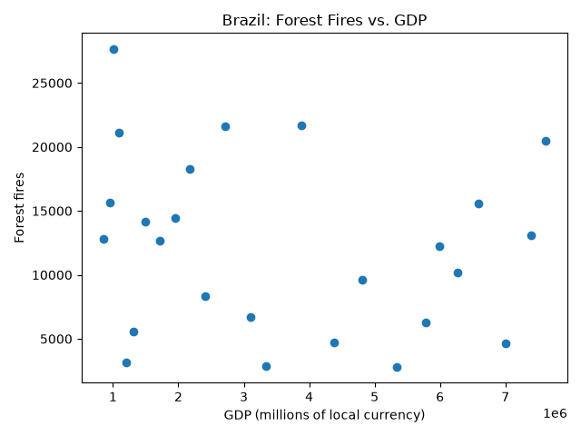
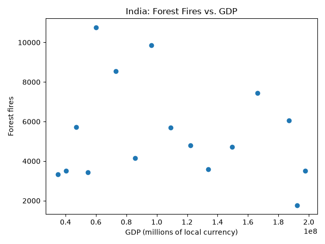
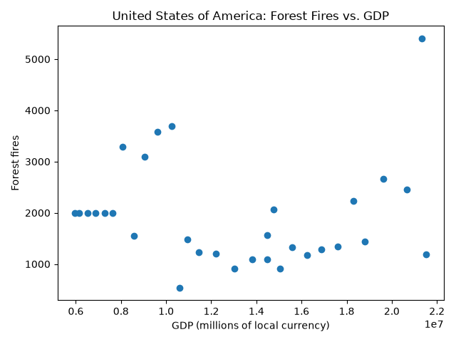
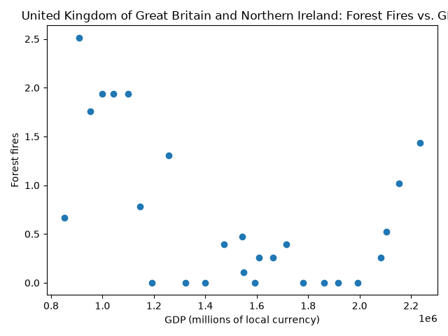

# Fire Emissions and GDP

This project combines forest-fire emissions data with GDP data by country and
year using test-driven development.

## Data

The two full data files can be downloaded with:

```bash
mkdir -p data

curl -L \
  "https://docs.google.com/uc?export=download&id=1AsXP_OGs1O_TDeXiZjk3fYV1SrG4vwXF" \
  -o data/Agrofood_co2_emission.csv

curl -L \
  "https://docs.google.com/uc?export=download&id=19YEPysdnK7VCXuAe9Og9pwYkNT5CbQzr" \
  -o data/IMF_GDP.csv
```

The full data files are stored in `data/` and are not committed to the
repository. Small test data files are stored in `test/data/`.

## Introduction

This analysis examines the relationship between forest-fire emissions and GDP
over time within individual countries. Forest-fire emissions come from the
Agrofood CO2 emissions dataset, while GDP comes from the IMF GDP dataset.

GDP is reported in millions of each country's local currency, so countries are
analyzed separately rather than pooling GDP values across countries.

Four countries were examined: Brazil, India, the United States of America, and
the United Kingdom of Great Britain and Northern Ireland.

## Results

The relationship between GDP and forest-fire emissions differed among the four
countries.

Brazil showed a weak negative association between GDP and forest-fire
emissions (Pearson r = -0.189, n = 25). India showed a similar weak negative
association (r = -0.192, n = 16).

The United States of America showed essentially no linear association
(r = 0.000, n = 31).

The United Kingdom of Great Britain and Northern Ireland showed the strongest
negative association among the four countries examined
(r = -0.496, n = 26).

These results are descriptive associations and do not demonstrate that changes
in GDP cause changes in forest-fire emissions.

### Brazil



### India



### United States of America



### United Kingdom of Great Britain and Northern Ireland



## Methods

The Agrofood CO2 dataset contains one row per country and year. The `Area`,
`Year`, and `Forest fires` columns were used. The IMF GDP dataset contains one
row per country, with individual years stored as columns.

The `get_fire_gdp_year_data()` function matches the two datasets by country and
year. Years with missing forest-fire values, missing GDP values, or years not
present in the GDP header are excluded.

Scatter plots were generated separately for each country using
`src/plot_fire_gdp.py`.

To reproduce the plots, run:

```bash
mkdir -p results

python src/plot_fire_gdp.py \
  --co2 data/Agrofood_co2_emission.csv \
  --gdp data/IMF_GDP.csv \
  --country Brazil \
  --out results/brazil_fire_gdp.png

python src/plot_fire_gdp.py \
  --co2 data/Agrofood_co2_emission.csv \
  --gdp data/IMF_GDP.csv \
  --country India \
  --out results/india_fire_gdp.png

python src/plot_fire_gdp.py \
  --co2 data/Agrofood_co2_emission.csv \
  --gdp data/IMF_GDP.csv \
  --country "United States of America" \
  --out results/united_states_fire_gdp.png

python src/plot_fire_gdp.py \
  --co2 data/Agrofood_co2_emission.csv \
  --gdp data/IMF_GDP.csv \
  --country "United Kingdom of Great Britain and Northern Ireland" \
  --out results/united_kingdom_fire_gdp.png
```

Pearson correlation coefficients were calculated separately within each
country using the matched year-level GDP and forest-fire values.

## Testing

Run the unit tests with:

```bash
python -m unittest discover -s test/unit -p "test_*.py" -v
```

Run the functional test with:

```bash
bash test/func/test_fire_gdp.sh
```

Run style checks with:

```bash
pycodestyle src/fire_gdp.py src/plot_fire_gdp.py test/unit/test_fire_gdp.py
```
